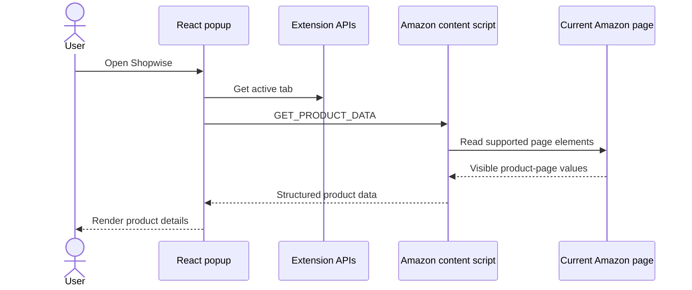

<div align="center">

# Shopwise
### An evidence-first shopping assistant for better product decisions

Compare what matters. Understand the trade-offs. Choose with confidence.

[](https://developer.mozilla.org/en-US/docs/Web/JavaScript)
[](https://react.dev/)
[](https://vite.dev/)
[](https://developer.chrome.com/docs/extensions/develop/migrate/what-is-mv3)
[](LICENSE)

**Project status: Phase 1 — browser extension foundation and local product extraction**

</div>

---

## Why Shopwise?

Shopping pages contain plenty of information, but making a good decision still takes work. Product specifications are written in inconsistent formats, review scores can hide recurring issues, and a higher price does not always mean better value.

**Shopwise is being built to turn product-page information into clear, explainable purchasing decisions.** It starts as a Chromium browser extension for Amazon product pages and is planned to grow into a comparison and recommendation system.

The guiding principle is **evidence before opinions**: deterministic code should extract, normalize and compare product facts; AI, when introduced, should explain verified evidence rather than invent specifications or make unsupported claims.

> The current implementation is an early foundation. Product comparison, review intelligence, price tracking, personalization, the backend and AI features below are planned work—not features available in the current build.

## What works today

### Phase 1 — implemented foundation

- [x] **Amazon product-page detection** on the configured Amazon.in and Amazon.com domains.
- [x] **Product information extraction** from the currently open product page: title, ASIN, displayed price, rating, ratings count, brand, image URL and up to six feature bullets.
- [x] **Brand text normalization** for common Amazon store-byline formats.
- [x] **Rating normalization** into a consistent `x.x / 5` display.
- [x] **Product image preview** with a fallback when the image URL is unavailable or invalid.
- [x] **Expandable product title** for long product names.
- [x] **One-click ASIN copy** from the extension popup.
- [x] **Amazon URL allowlist** using HTTPS and exact hostname matching to reject lookalike domains.
- [x] **Automated URL validation tests** using Node.js's built-in test runner.
- [x] **Local-first extraction**: Phase 1 does not send extracted product details to a Shopwise backend or an LLM service.

Extraction depends on the page markup and the information Amazon makes visible on that listing. A field can be unavailable for some products or page layouts.

## Product direction: features that will make Shopwise stand out

These are proposed differentiators for the upcoming phases. They are intentionally designed around explainability, data quality and usefulness—not just adding an AI chat box.

### 1. Explainable product scoring

A comparison should show *why* a product ranks well, not just display a score.

- Configurable priorities such as price, performance, battery, display, portability and reliability.
- Separate views such as **Best Overall**, **Best Value** and **Best for Your Use Case**.
- Transparent scoring weights and a breakdown of the factors affecting each result.
- Missing or unavailable specifications treated as **unknown**, never silently treated as zero or guessed.
- A data-coverage indicator so users can see when a recommendation is based on incomplete information.

**Why it stands out:** it makes recommendations inspectable and helps users understand trade-offs instead of asking them to trust a black-box ranking.

### 2. Category-aware specification intelligence

Product specifications are not comparable until they are represented consistently.

- Normalize equivalent labels and values (for example, `8 GB RAM`, `8GB` and `RAM: 8 GB`).
- Use category-specific schemas for laptops, smartphones, monitors and other product types.
- Separate comparable attributes from category-specific attributes.
- Flag conflicting, ambiguous or missing values rather than silently choosing one.
- Show the original extracted value alongside its normalized representation.

**Why it stands out:** the same comparison engine can support multiple product categories without pretending that every product can be evaluated using the same checklist.

### 3. ReviewLens — aspect-based review intelligence

A star rating compresses many different customer experiences into one number. ReviewLens is planned to surface the themes behind those ratings.

- Group review themes by aspects such as battery, display, camera, thermals, build quality and support.
- Summarize recurring positive and negative themes.
- Show representative review excerpts and their source where permitted.
- Distinguish review volume from sentiment so a small number of comments is not presented as consensus.
- Present suspicious-pattern indicators as signals for further review—not as definitive proof that a review is fake.

**Why it stands out:** it aims to answer *what do owners repeatedly like or dislike?* rather than simply repeating the average rating.

### 4. Evidence-grounded AI explanations

AI should make the comparison easier to understand, while the underlying product facts remain independently inspectable.

- Generate concise pros, cons and trade-off summaries from structured product data.
- Link each factual claim to the product field or review evidence that supports it.
- Return structured output that the application can validate before displaying it.
- Explicitly state when information is missing or uncertain.
- Prevent the model from inventing specifications, prices, review counts or product capabilities.

**Why it stands out:** the LLM acts as an explanation layer over verified data—not as the source of truth.

### 5. Personal shopping profiles and budget-aware decisions

The best product depends on what the buyer needs.

- Save preferences such as budget, intended use and must-have features.
- Support profiles such as student, programmer, gamer, traveller or content creator.
- Let users adjust the importance of individual criteria.
- Explain which requirements a product meets, misses or cannot verify.
- Show the cost of a trade-off—for example, how much more a user pays for a particular upgrade.

**Why it stands out:** two users can receive different, explainable rankings from the same shortlist because their priorities are different.

### 6. Price intelligence and deal context

A discount badge alone does not establish that a product is a good deal. Planned price intelligence will focus on context.

- Build price history from user-authorized observations or permitted data sources.
- Show observed price changes and the time period covered.
- Notify users when a watched product reaches a chosen target price, where supported.
- Distinguish an observed price from an estimated or unavailable price.
- Add a deal-context indicator only when enough trustworthy history exists.

**Implementation constraint:** price history and alerts will use permitted APIs, authorized sources or user-initiated observations. The project will not bypass CAPTCHAs, access controls or anti-bot protections.

### 7. Multi-store comparison

Once the Amazon workflow is reliable, the data model can be extended to compare equivalent products across supported retailers.

- Normalize product identity, model numbers and variant details.
- Compare total cost, including delivery or other known charges when available.
- Make seller, source and last-observed time visible.
- Avoid comparing different configurations as if they were the same product.

**Why it stands out:** it can move Shopwise from a single-store helper toward a broader shopping decision tool, while keeping source provenance visible.

## Roadmap

| Phase | Focus | Planned deliverables |
| --- | --- | --- |
| **1. Foundation** | Browser extension and extraction | Manifest V3, React popup, Amazon page detection, metadata extraction, image preview, ASIN copy and URL validation. |
| **2. Comparison engine** | Reliable product data and deterministic scoring | Product schema, category-aware normalization, comparison shortlist, side-by-side table, weighted scoring and missing-data handling. |
| **3. Backend and AI** | Persistence and evidence-grounded explanations | Python FastAPI, MySQL, SQLAlchemy, Pydantic schemas, comparison APIs and validated LLM summaries. |
| **4. Shopping intelligence** | Personalization and review/price context | Preference profiles, ReviewLens, explainable recommendation reports, price observations and supported alerts. |
| **5. Release readiness** | Quality, security and distribution | Cross-page testing, integration tests, accessibility, browser compatibility, privacy review, deployment and release documentation. |

## How Phase 1 works

The extension reads the product page the user already has open. It does not run a crawler or send the extracted product details to a remote Shopwise service.



### Current product data shape

The content script returns a product object with the following fields when they can be read from the current page:

```json
{
  "asin": "B0XXXXXXXX",
  "title": "Product title shown on the page",
  "price": "Displayed price or availability message",
  "rating": "4.5 / 5",
  "reviewCount": "1,234",
  "brand": "Brand name or availability message",
  "image": "https://...",
  "features": [
    "Feature bullet from the product page"
  ],
  "url": "https://www.amazon.in/dp/B0XXXXXXXX",
  "extractedAt": "2026-01-01T12:00:00.000Z"
}
```

The values above illustrate the response shape; they are not live product data. The price, rating, ratings count and brand are page-derived strings. They are not independently verified by a retailer API in Phase 1.

## Architecture and technology

### Current stack

| Layer | Technology | Responsibility |
| --- | --- | --- |
| Extension UI | React + JavaScript | Product details, loading/error states and popup interactions. |
| Build tooling | Vite | Development server and production build. |
| Extension platform | Chromium Manifest V3 | Popup, content-script registration and browser permissions. |
| Page integration | JavaScript content script | Reads supported product details from the active Amazon page. |
| URL validation | JavaScript ES module | Allows only configured HTTPS Amazon hostnames. |
| Tests | Node.js built-in test runner | Verifies supported and rejected URL cases. |

### Planned backend stack

| Layer | Planned technology | Responsibility |
| --- | --- | --- |
| API | Python + FastAPI | Product, comparison and recommendation endpoints. |
| Validation | Pydantic | Validate product and comparison payloads. |
| Persistence | MySQL + SQLAlchemy | Store user-authorized saved comparisons and preferences. |
| AI | Provider-independent LLM integration | Explain structured findings and summarize supported review evidence. |

The backend stack is planned; it is not part of the current Phase 1 build.

## Repository structure

```text
shopping-assistant/
├── public/
│   ├── manifest.json          # Manifest V3 configuration
│   └── content.js             # Amazon product-page extraction
├── src/
│   ├── main.jsx               # React popup and product UI
│   ├── style.css              # Popup styling
│   └── utils/
│       └── amazonUrl.js       # Supported Amazon URL validation
├── tests/
│   └── amazonUrl.test.js      # URL validation tests
├── popup.html                 # Vite entry HTML
├── vite.config.js             # Vite configuration
├── package.json               # Dependencies and scripts
├── .gitignore
└── README.md
```

## Getting started

### Prerequisites

- Node.js **20.19.0 or later**, matching the version requirement in `package.json`.
- npm.
- Chrome or another Chromium-based browser with support for unpacked Manifest V3 extensions. Opera is the initial manual test browser for this project.

### 1. Clone the repository

```bash
git clone https://github.com/priyanshu015211/shopping-assistant.git
cd shopping-assistant
```

### 2. Install dependencies

```bash
npm install
```

### 3. Run the URL validation tests

```bash
npm test
```

### 4. Build the extension

```bash
npm run build
```

Vite creates the unpacked extension in the `dist/` directory. The build includes the manifest and content script copied from `public/`.

### 5. Load the extension in your browser

**Chrome**

1. Open `chrome://extensions`.
2. Enable **Developer mode**.
3. Select **Load unpacked**.
4. Choose the project's `dist/` directory—not the repository root.

**Opera**

1. Open `opera://extensions`.
2. Enable **Developer mode**.
3. Select **Load unpacked**.
4. Choose the project's `dist/` directory.

Then:

1. Open an individual product detail page on Amazon.in or Amazon.com.
2. Refresh the product page after installing or reloading the extension.
3. Open Shopwise from the browser toolbar.
4. Review the extracted fields, expand the title if needed, and try copying the ASIN.
5. Verify current price and availability on the Amazon page before making a purchase.

### Development commands

| Command | Purpose |
| --- | --- |
| `npm run dev` | Start the Vite development server for popup UI work. |
| `npm test` | Run the Node.js URL validation tests. |
| `npm run build` | Create the production extension in `dist/`. |
| `npm run preview` | Preview the Vite build locally. |

After changing extension code, rebuild the project, reload Shopwise on the browser extensions page, refresh the Amazon product tab and reopen the popup. The content script runs in the product tab, so refreshing that tab is important after content-script changes.

## Testing

The current automated tests cover these URL-validation behaviours:

- Accept configured Amazon.in and Amazon.com hostnames.
- Reject unrelated and lookalike domains.
- Reject insecure schemes and non-standard ports.
- Reject URLs containing embedded credentials.
- Handle malformed URLs and non-string input without throwing.

Product extraction currently has manual browser verification; automated DOM fixtures and end-to-end tests are planned for a later phase.

## Supported marketplaces and current limitations

### Supported now

- `https://amazon.in`
- `https://www.amazon.in`
- `https://amazon.com`
- `https://www.amazon.com`

### Known limitations

- Amazon page markup can change, which may make individual fields unavailable or require selector updates.
- Extraction is based on the currently open product detail page; it is not a product search engine or crawler.
- Only fields visible through the configured page selectors are extracted.
- Price, rating, ratings count and brand are not independently verified against an official product API.
- The configured marketplaces are limited to Amazon.in and Amazon.com.
- Product comparison, saved lists, review collection/analysis, price history, notifications, user accounts, FastAPI, MySQL and LLM integration are not implemented in Phase 1.
- The extension does not bypass CAPTCHAs, access restrictions or anti-bot protections.

## Privacy and permissions

Phase 1 is designed to keep extraction local to the browser workflow.

| Permission / access | Current purpose |
| --- | --- |
| `activeTab` | Work with the active tab when the user opens the extension. |
| `clipboardWrite` | Copy the product ASIN when the user selects the Copy action. |
| Amazon content-script match patterns | Run the extraction script only on the configured Amazon.in and Amazon.com domains. |

In the current implementation, extracted product fields are returned from the content script to the extension popup. They are not sent to a Shopwise backend, stored in MySQL or submitted to an LLM. The product image is displayed using the image URL present on the Amazon page.

Future backend and AI features should make any data transfer explicit, minimize retained data and provide clear controls for saved product information and user preferences.

## Contributing

Contributions, bug reports and suggestions are welcome.

1. Open an issue describing the problem or proposed improvement.
2. Keep changes focused and include tests for new utility logic where practical.
3. Run `npm test` and `npm run build` before opening a pull request.
4. Describe what changed, how it was tested and any known limitations.

For Amazon extraction changes, include the affected marketplace and product-page behaviour without publishing personal account information or sensitive browsing data.

## License

This project is licensed under the MIT License. See [LICENSE](LICENSE) for details.

## Disclaimer

Shopwise is an independent educational software project and is not affiliated with, endorsed by, or sponsored by Amazon. Product names, prices, ratings, review counts and availability are supplied by the retailer's pages and may change. Always verify details on the retailer's website before purchasing.

---

<div align="center">

**Shopwise — from product information to informed decisions.**

</div>
